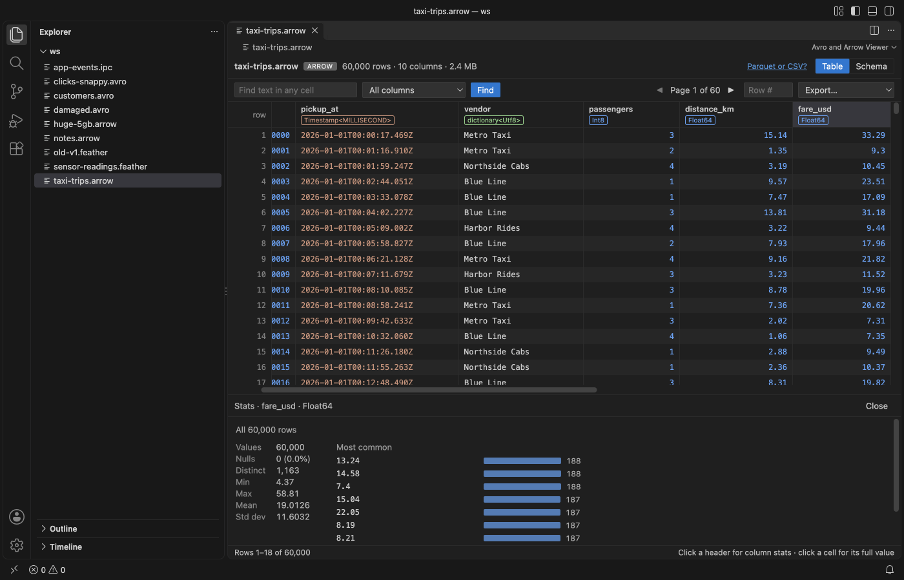
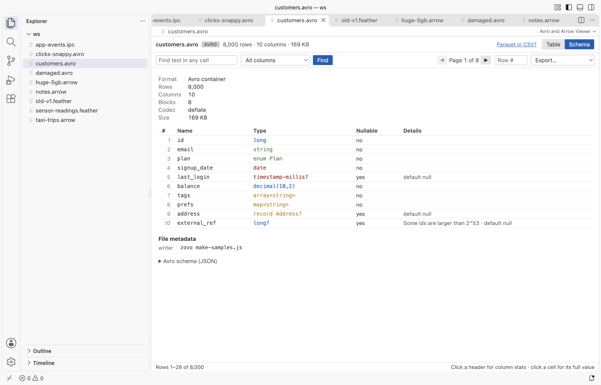
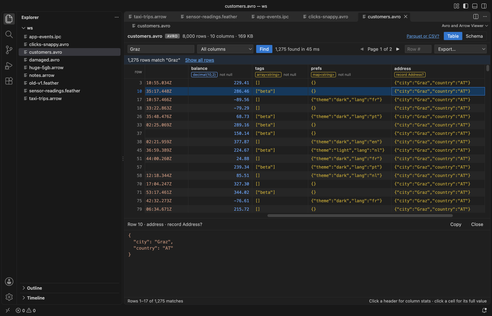

# Avro Viewer, Arrow Viewer & Feather Viewer

Click an `.avro`, `.arrow`, `.feather` or `.ipc` file and read it as a table in VS Code, with no Python and no upload.

*Screenshots come from the extension running in VS Code 1.142 on files made by `scripts/make-samples.js`. No real data appears.*

- It opens big files fast. The viewer reads only the file header and the batch or block index, then decodes the record batch (Arrow) or block (Avro) that you scroll to. A 37 MB, 1.5 million row file shows its first rows in about 10 ms in the test suite.
- It reads the files people actually write. Feather V2 from pandas and pyarrow (LZ4 and ZSTD), Arrow IPC file and stream format, and Avro with the null, deflate, snappy and zstandard codecs. 64-bit integers above 2^53 stay exact, and decimals, dates, timestamps, structs, lists and maps show as real values.
- It answers the first questions about a dataset. The Schema tab lists every column with its type and nullability. Click a header for nulls, distinct count, min, max, mean and the most common values. Find searches every row with a Cancel button, and Export writes a page or all rows to CSV or JSON.

## Quick start

1. Install the extension and click any `.avro`, `.arrow`, `.arrows`, `.feather` or `.ipc` file.
2. Scroll or use the pager, open the Schema tab, or click a column header for its stats.

Run "Avro and Arrow Viewer: Get Started" for a short tour.

## More pictures

| Schema with types and nullability | Avro file with search results |
|---|---|
|  |  |

## What you can do

The table shows 200 rows per request and keeps only a few decoded batches in memory. The pager at the top right shows the page you are on (1,000 rows a page) and jumps a page at a time. Type a number in Row # to jump to that row. Click a cell to see its full value below the table, with JSON formatting for nested values and a Copy button.

Each column header shows the name, a short type and "not null" when the schema says so. Arrow types come from the IPC schema, such as `Int64`, `Timestamp<MILLISECOND, UTC>` or `dictionary<Utf8>`. Avro types are written short, such as `string?` for a union with null, `array<string>`, `enum Plan` or `decimal(10,2)`.

Click a header to compute stats for that column. The stats read every row (or every match after Find) in the background, update as they go, and stop when you click Cancel or close the panel. Distinct values are counted exactly up to 100,000.

Find matches text in any column, or in the one you pick, ignoring case. It runs in the extension host with a progress count. Cancel keeps the matches found so far. Show all rows clears the search.

Export has four choices. You can save this page or all rows, each as CSV or JSON. After a search, "all rows" means all matches. Nested values go into CSV cells as JSON text. A CSV can open in Table Viewer by Zovo straight from the message that confirms the export.

The Schema tab also shows the format, metadata version, compression or codec, the number of record batches or blocks, the dictionaries, the file metadata (for example the pandas metadata that pyarrow writes) and, for Avro, the raw schema JSON.

## Formats

| Extension | Read as |
|---|---|
| `.feather` | Feather V2 (Arrow IPC file), uncompressed, LZ4 frame or ZSTD |
| `.arrow` | Arrow IPC file format, or stream format if there is no file header |
| `.arrows`, `.ipc` | Arrow IPC stream format, or file format if the header says so |
| `.avro` | Avro object container file with the null, deflate, snappy or zstandard codec |

The reader is picked from the first bytes of the file, so a stream saved as `.arrow` still opens.

## Limits

| What | Limit |
|---|---|
| File size | Up to 4 GB. Bigger files show a message instead of loading. |
| One record batch or Avro block | Up to 1 GB, since it is decoded whole when you scroll to it. |
| Remote files (virtual workspaces) | Read whole, up to 256 MB. |
| Search results | The first 5,000,000 matches. |
| Feather V1 | Not supported. Files written before 2020 get a message that explains how to save them as V2. |
| Avro bzip2 and xz codecs | Not supported. The message names the codec. |
| ORC and Parquet | Not read here. Parquet opens in Table Viewer by Zovo. |

## Privacy

The extension runs offline. It makes no network calls and has no telemetry. It never writes to the file you are viewing; Export always asks for a new file. The webview runs under a strict Content Security Policy with no remote scripts, and file content goes into the page only as text.

## Settings

| Setting | Default | What it does |
|---|---|---|
| `arrowAvroViewer.askForRating` | `true` | Ask one time for a Marketplace rating after a few days of use. Nothing is sent anywhere. |
| `arrowAvroViewer.showSupportLinks` | `true` | Show the small Sponsor and More free viewers links in the status line. |

## Libraries

Apache Arrow for JavaScript (Apache-2.0), avsc (MIT), fzstd (MIT), lz4js (ISC) and snappyjs (MIT). The license texts are in `THIRD-PARTY-NOTICES.txt`.

## Support

Zovo extensions have no ads and no tracking, and sponsors pay for the time that goes into fixes and new viewers. You can sponsor the work on [GitHub Sponsors](https://github.com/sponsors/theluckystrike).

## More viewers by Zovo

- [CSV Viewer, Excel Viewer & Parquet Viewer](https://marketplace.visualstudio.com/items?itemName=zovo.table-viewer-vscode) opens CSV, TSV, Excel and Parquet files as a sortable, filterable table.
- [JSONL Viewer & NDJSON Table Viewer](https://marketplace.visualstudio.com/items?itemName=zovo.zovo-jsonl-viewer) opens JSONL and NDJSON files as a table, as records or as a chat view.
- [SQLite Viewer & DB Viewer (Read-Only)](https://marketplace.visualstudio.com/items?itemName=zovo.sqlite-table-viewer) browses SQLite tables read-only and runs SELECT queries.
- [PDF Viewer & PDF Reader with Dark Mode](https://marketplace.visualstudio.com/items?itemName=zovo.pdf-viewer-dark) reads PDFs with a real dark mode, search, an outline and thumbnails.
- [DOCX Viewer & Word Viewer with Dark Mode](https://marketplace.visualstudio.com/items?itemName=zovo.docx-viewer-vscode) previews Word and ODT files with dark mode, an outline and search.
- [PPTX Viewer & PowerPoint Viewer](https://marketplace.visualstudio.com/items?itemName=zovo.pptx-slide-viewer) shows PowerPoint slides, thumbnails and speaker notes.
- [Large JSON Viewer & JSON Tree](https://marketplace.visualstudio.com/items?itemName=zovo.zovo-json-tree-viewer) shows large JSON files as a searchable tree, copies JSONPath and turns arrays of objects into a table.
- [HDF5 & NetCDF Explorer (H5 Viewer)](https://marketplace.visualstudio.com/items?itemName=zovo.hdf5-netcdf-explorer) browses groups, attributes and values in HDF5 and NetCDF files and plots slices.
- [GGUF, Safetensors & NPY Viewer (NumPy Viewer)](https://marketplace.visualstudio.com/items?itemName=zovo.tensor-viewer) shows NPY, NPZ, Safetensors and GGUF tensors with stats and heatmaps.
- [MP4 Video Player & Video Preview with Sound](https://marketplace.visualstudio.com/items?itemName=zovo.video-preview-with-sound) plays MP4, MOV, MKV and WebM files with their sound.
- [DXF Viewer & CAD Viewer for 2D Drawings](https://marketplace.visualstudio.com/items?itemName=zovo.dxf-viewer) opens ASCII and binary DXF drawings with layers, measuring and PNG or SVG export.
- [AGENTS.md & CLAUDE.md Linter (Context Drift)](https://marketplace.visualstudio.com/items?itemName=zovo.context-drift) finds stale commands, paths and versions in AGENTS.md and CLAUDE.md files.
- [Agent Skills & Claude Skills (Skill Shelf)](https://marketplace.visualstudio.com/items?itemName=zovo.skill-shelf) lists, checks and toggles the Agent Skills that Claude Code, Codex and Cursor load.
- [Claude Code History & Codex History Viewer](https://marketplace.visualstudio.com/items?itemName=zovo.agent-session-viewer) browses and searches your local Claude Code and Codex sessions.
- [Claude Code Usage & Codex Usage Cost Meter](https://marketplace.visualstudio.com/items?itemName=zovo.ai-usage-meter) shows Claude Code and Codex tokens and estimated cost from your local session files.

Coming soon to the Marketplace, with the code on GitHub now.

- [PKL Viewer & Pickle Viewer](https://github.com/theluckystrike/pickle-viewer-vscode) opens Python pickle files without Python and never runs their code.
- [Audio Preview & Loudness Meter](https://github.com/theluckystrike/audio-preview-vscode) plays audio files with a waveform, a spectrogram and LUFS loudness.
- [Graphviz Preview & DOT Viewer](https://github.com/theluckystrike/graphviz-preview-vscode) shows a live preview of DOT files and exports SVG or PNG.
- [TIFF Viewer (16-bit, Float, GeoTIFF)](https://github.com/theluckystrike/tiff-viewer-vscode) opens 16-bit, float, multi-page and GeoTIFF images.
- [EML Viewer & MBOX Email Viewer](https://github.com/theluckystrike/eml-viewer-vscode) reads EML, EMLX and MBOX email files with remote images blocked.
- [3D Model Viewer (GLB, glTF, STL, OBJ, PLY)](https://github.com/theluckystrike/model-viewer-vscode) views GLB, glTF, STL, OBJ, PLY and 3MF models.
- [DICOM Viewer & NIfTI Viewer for CT and MRI](https://github.com/theluckystrike/dicom-nifti-viewer-vscode) opens CT and MRI scans, DICOM folders and NIfTI volumes with window presets and three views.
- [ZIP Viewer & Archive Explorer (JAR, TAR, GZ)](https://github.com/theluckystrike/archive-explorer-vscode) browses ZIP, JAR, VSIX, TAR and GZ files, opens entries in tabs and extracts them safely.
- [GCode Viewer & 3D Print Preview](https://github.com/theluckystrike/gcode-viewer-vscode) shows GCode toolpaths in 3D layer by layer, with print time and filament use.
- [EPUB Reader & EPUB Viewer](https://github.com/theluckystrike/epub-reader-vscode) reads EPUB books with a table of contents, search and light, sepia or dark themes.
- [File Viewers Pack](https://github.com/theluckystrike/zovo-file-viewers) installs the PDF, table, Word, PowerPoint, HDF5 and tensor viewers in one step.

## License

MIT. Not affiliated with the Apache Software Foundation. Apache Arrow and Apache Avro are trademarks of the Apache Software Foundation.
